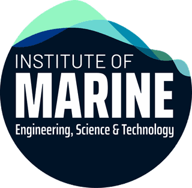
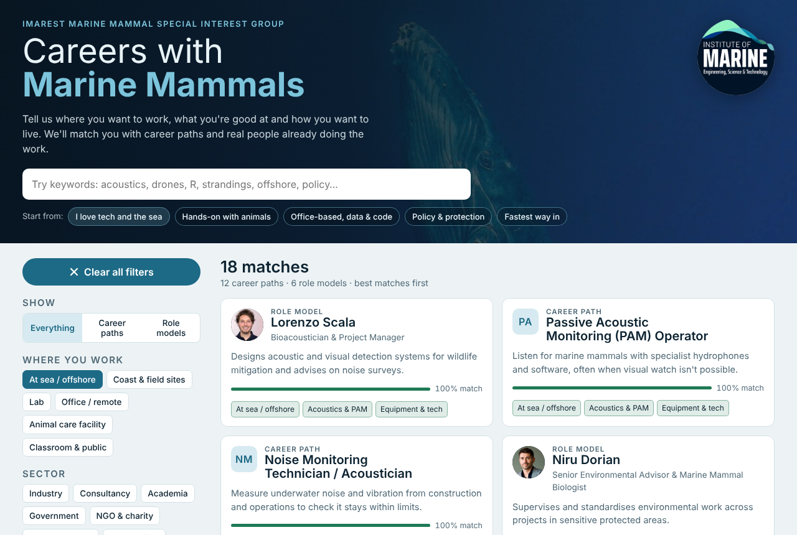
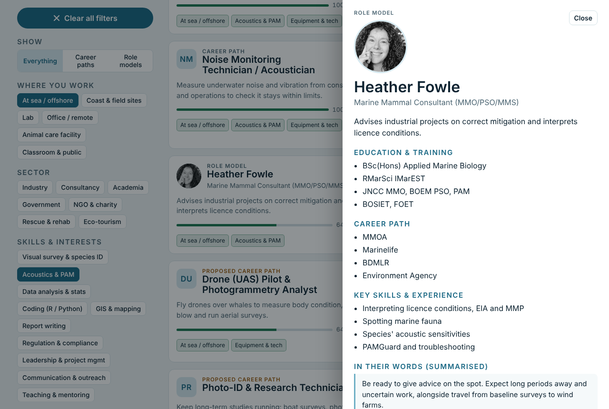
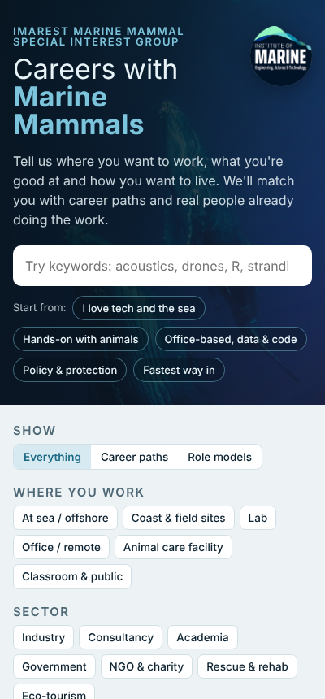

<p align="center">
  
</p>

<h1 align="center">Marine Mammal Career Finder</h1>

<p align="center">
  <strong>An interactive refresh of the IMarEST Marine Mammal Special Interest Group's<br>"Careers with Marine Mammals" guide.</strong>
</p>

<p align="center">
  <a href="#run-it"></a>
  <a href="#add-or-edit-a-profile"></a>
  <a href="docs/Careers-with-Marine-Mammals-IMarEST-MMSIG-2022.pdf"></a>
  
</p>

<p align="center">
  
</p>

---

## What it does

The original guide is an 11-page PDF of tables and role model case studies. This tool turns that content into something people can **explore by what they want**:

- **Filter** by where you'd work (at sea, lab, office, animal care facility…), sector, skills and interests, lifestyle (offshore rotations, on-call, one base…) and typical entry level.
- **Type keywords** like `acoustics`, `R`, `drones`, `strandings` or `policy`. Common terms map to the right skill tags, and everything else is searched across the full profile text.
- **Get ranked matches** with a match score and the exact reasons each profile matched.
- **Open any profile** for activities, education, career progression, key skills and advice, plus links to similar profiles.
- **Jump in with presets** such as *I love tech and the sea* or *Fastest way in*.

<p align="center">
  
  &nbsp;
  
</p>

## What's inside

| | Count | Source |
|---|---:|---|
| Career paths | 18 | Every role type in the 2022 guide's tables |
| Role models | 11 | IMarEST role model case studies in the guide |
| **Proposed** career paths | 7 | New drafts for SIG review (clearly labelled in the tool, and can be hidden) |

The proposed additions are: Bioacoustic Data Scientist, Protected Species Biologist (Government), Drone (UAS) Pilot & Photogrammetry Analyst, Photo-ID & Research Technician, Science Communicator / Educator, Marine Spatial Planner and Fisheries Observer (bycatch).

> **Note:** Setting, lifestyle and entry-level tags were assigned from the guide's text and should be checked by practitioners. Proposed profiles need review before public release.

## The original guide

📄 [**Careers with Marine Mammals** (IMarEST MM SIG, 2022) — PDF](docs/Careers-with-Marine-Mammals-IMarEST-MMSIG-2022.pdf)

Full role model case studies: [imarest.org/rolemodels](https://www.imarest.org/rolemodels)

## Run it

There's no build step. It's plain HTML, CSS and JavaScript.

- **Locally:** open `index.html` in a browser, or serve the folder:
  ```bash
  python3 -m http.server 8000
  # then visit http://localhost:8000
  ```
- **GitHub Pages:** push this repo, then go to **Settings → Pages**, choose **Deploy from a branch**, select `main` and `/ (root)`. The site will appear at `https://<your-username>.github.io/imarest-marine-mammal-career-finder/`.

## Add or edit a profile

All content lives in **[`data/profiles.js`](data/profiles.js)**, so editing it never touches the page code.

```js
{
  id: "heather",                 // unique; role model photos use assets/people/<id>.jpg
  kind: "person",                // "role" = career path, "person" = role model
  draft: false,                  // true = proposed career awaiting SIG review
  person: "Heather Fowle",       // role models only
  title: "Marine Mammal Consultant (MMO/PSO/MMS)",
  summary: "One sentence on what the work is.",
  setting:   ["At sea / offshore"],          // values must come from FACETS
  sector:    ["Consultancy", "Industry"],
  skills:    ["Visual survey & species ID", "Acoustics & PAM"],
  lifestyle: ["Long offshore rotations"],
  entry:     ["Bachelor's"],
  activities: [...], education: [...], path: [...], keyskills: [...],
  advice: "A short summary of their drivers and challenges."
}
```

To add a role model:

1. Add an entry to `P` in `data/profiles.js` with `kind: "person"`.
2. Save a square headshot (about 320×320 px) as `assets/people/<id>.jpg`.
3. Get the person's permission to use their photo and story.

To add a new filter option (for example a new skill), add it to the matching list in `FACETS` first, then use it in profiles. To make a keyword point at a tag, add it to the `SYN` map in `index.html`.

## Project structure

```
imarest-marine-mammal-career-finder/
├── index.html              # the app (layout, styles, matching logic)
├── data/
│   └── profiles.js         # all career paths, role models, filters and presets
├── assets/
│   ├── imarest-logo.png
│   ├── people/             # role model headshots from the 2022 guide
│   └── photos/             # humpbacks, sea lion, dolphins from the guide
└── docs/
    ├── Careers-with-Marine-Mammals-IMarEST-MMSIG-2022.pdf
    └── screenshots/
```

## Ideas for next steps

- A submission form so SIG members can propose new role models
- Practitioner review of the proposed career paths and tags
- Salary ranges, typical training providers and certification links per path
- Region filters (UK, US, EU, Australia…) for regulations and certifications

## Credits

Content adapted from *Careers with Marine Mammals* by the [Institute of Marine Engineering, Science & Technology (IMarEST)](https://www.imarest.org) Marine Mammal Special Interest Group. Photos and role model case studies are from that guide. The IMarEST name and logo belong to IMarEST.

Built as a prototype for the IMarEST MM SIG.
